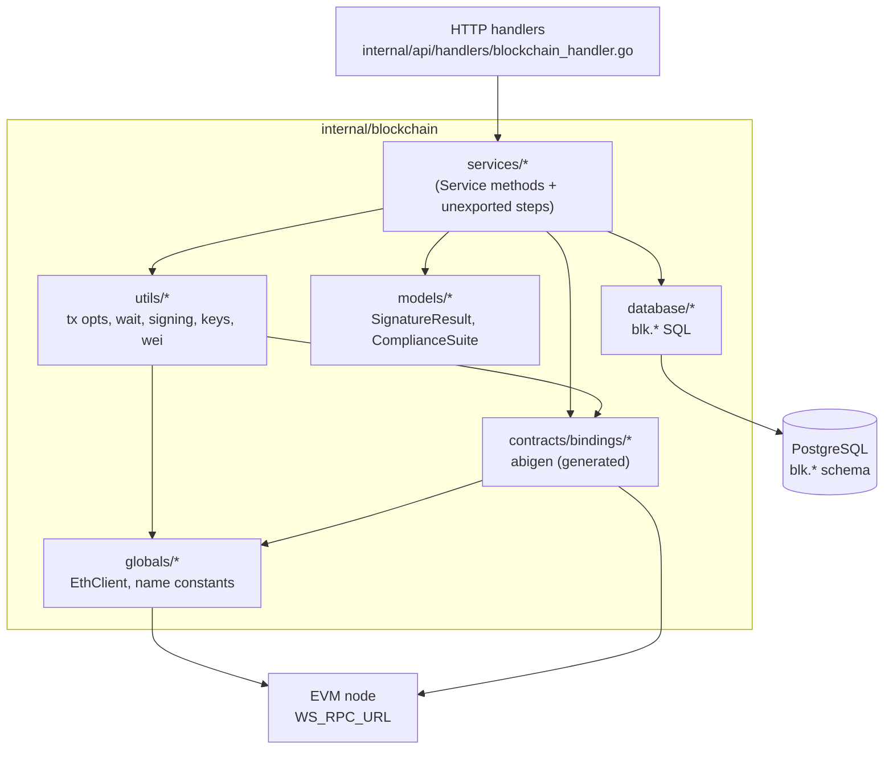
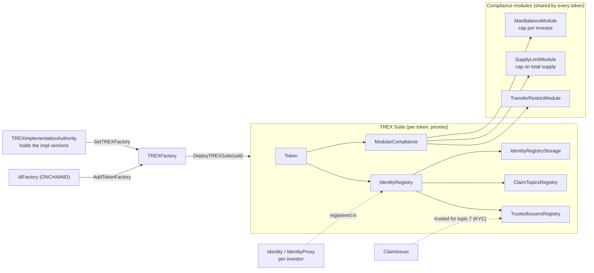
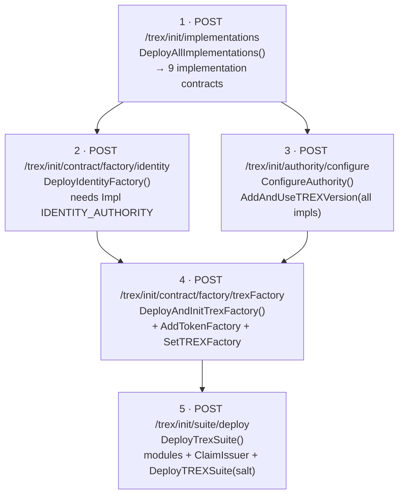
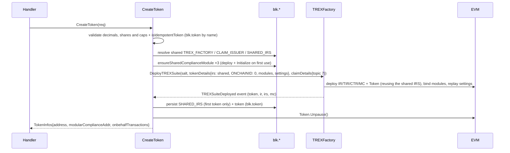
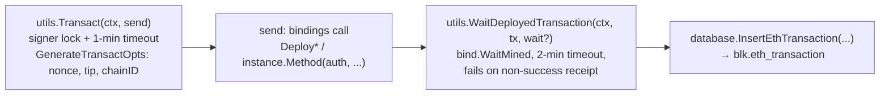

# Blockchain module (`internal/blockchain`)

This package is the on-chain engine of Tooken-Services. It deploys and operates an
[ERC-3643 / T-REX](https://docs.erc3643.org/) permissioned security-token
infrastructure on an EVM chain and exposes it to the rest of the API. T-REX makes
tokens *permissioned*: only wallets that carry a verified on-chain **Identity**
(ONCHAINID) with the required **claims** (e.g. KYC) can hold or receive tokens, and
every transfer is checked by a **ModularCompliance** contract.

The module never talks to end users directly. HTTP handlers in
`internal/api/handlers/blockchain_handler.go` call the exported `*Service` methods
documented here; long-running deployments run asynchronously and return `202`.

---

## 1. Responsibilities at a glance

| Concern | Where |
|---|---|
| Smart-contract Go bindings (abigen, **generated**) | `contracts/bindings/` |
| Business logic / orchestration | `services/` |
| Persistence (raw SQL, `blk.*` schema) | `database/` |
| Plain Go domain structs | `models/` |
| Signing, gas, encoding, unit conversion helpers | `utils/` |
| Eth client + contract-name constants + mutable address cache | `globals/` |

### Directory layout

```
internal/blockchain/
├── contracts/bindings/      # 1 generated .go per Solidity contract (DO NOT EDIT)
│   ├── Token.go  TokenProxy.go  Identity.go  IdentityProxy.go  IdFactory.go
│   ├── IdentityRegistry.go  IdentityRegistryStorage.go  ClaimIssuer.go
│   ├── ClaimTopicsRegistry.go  TrustedIssuersRegistry.go  ModularCompliance.go
│   ├── ModularComplianceProxy.go  TransferRestrictModule.go
│   ├── TREXFactory.go  TREXImplementationAuthority.go  ImplementationAuthority.go
├── services/                # all .go are package `services`, one *Service receiver
├── database/                # package `database`, raw SQL over globals.DB
├── models/                  # SignatureResult, ComplianceSuite, ComplianceModule
├── utils/                   # GenerateTransactOpts, WaitDeployedTransaction, keys, ...
└── globals/                 # EthClient, contract-name constants, address cache
```

All service files share a single `Service` struct (`services/services.go`,
`NewService()`); it is **stateless** — methods receive everything they need via
arguments and globals.

---

## 2. Architecture & layering



**Read the dependency edges as the contract for new code:** services orchestrate;
they reach the chain through `bindings` + `globals.EthClient`, sign through
`utils`, and persist through `database`. `database` and `bindings` never call back
into `services`.

---

## 3. The T-REX object model (what gets deployed)



Most concrete contracts are **proxies** pointing at shared *implementations*; the
`TREXImplementationAuthority` is the single source of truth for which
implementation version every proxy uses.

The three compliance modules are **singletons**: one instance of each, bound to every
token's `ModularCompliance`. They keep their state **per compliance**, so one shared
`MaxBalanceModule` still holds a different cap for each token.

---

## 4. Platform bootstrap (one-time, ordered)

These five endpoints must be called in order; each step consumes addresses
produced by earlier ones. Steps 1, 4 and 5 are asynchronous (`202`).



Step 1 (`services/implementation_contracts.go`) deploys, in this exact order:
`ClaimTopicsRegistry`, `TrustedIssuersRegistry`, `IdentityRegistryStorage`,
`IdentityRegistry`, `ModularCompliance`, `Token`, `Identity`,
`ImplementationAuthority` (for identities), and `TREXImplementationAuthority`
(reference, `isReference=true`).

Step 5 (`services/TREX_factory.go → DeployTrexSuite`) hard-codes the first suite:
name `TREXSuiteV1`, symbol `TOOK`, 18 decimals, compliance = `TransferRestrictModule`,
claim topic `7` (KYC), salt `TookenSuiteV1Salt`. It waits on the
`TREXSuiteDeployed` event rather than the tx receipt.

Each step records what it deploys, so the next one finds it without any manual
seeding: step 1 writes the nine rows of `blk.contract_implementation`, steps 2,
4 and 5 write `IDENTITY_FACTORY`, `TREX_FACTORY`, `CLAIM_ISSUER`,
`TRANSFER_RESTRICTION_MODULE` and `SHARED_IRS` to `blk.contract_role`. The
end-to-end test (`internal/e2e`, see [§9](#9-tests)) runs the five steps on an
empty database through the API and checks those rows. Step 2 is idempotent: a
second call answers with the factory already recorded and sends no transaction.

---

## 5. Runtime operations (per investor / per token)

### 5.1 Create an investor Identity — `CreateIdentity` (`services/identity.go`)

`POST /contract/identity`

1. Idempotency via `GetWalletByUserId` (**currently mocked**, always returns an
   address ⇒ effectively short-circuits — see §8).
2. `GenerateNewWallet` — generate an ECDSA keypair, persist it to `blk.user_wallet`.
3. `deployIdentityProxy` — deploy an `IdentityProxy` against the identity
   implementation authority.
4. `registerIdentity` — `IdentityRegistry.RegisterIdentity(wallet, identity, country)`.
5. `InsertIdentity` into `blk.identity`.

### 5.2 Add a claim — `AddClaimToIdentity` (`services/identity_claim.go`)

`POST /contract/identity/claims/add`

Looks up the user's Identity (`blk.identity`), builds an ERC-734/735 signature off
the platform `PRIVATE_KEY` (`generateSignatureAddClaim`: abi-encode
`address,uint256,bytes` → keccak256 → `\x19Ethereum Signed Message` → `crypto.Sign`),
then `Identity.AddClaim(topic, scheme=1, issuer=CLAIM_ISSUER, signature, "OK", "")`.
Claim payload data is the constant string `"OK"`.

### 5.3 Create a Token (standalone path) — `CreateToken` (`services/token.go`)

`POST /contract/token`. Distinct from `DeployTrexSuite`: it assembles a token by
hand against an **existing** `IdentityRegistry` instance read from
`blk.contract_instance`.



`CreateToken` goes through the **shared `TREXFactory`** (canonical T-REX path), not a
hand-wired proxy. It reuses the shared infrastructure — one factory, one
`ClaimIssuer`, one manager (`ethFrom`), and one **IRS** (so the investor whitelist is
shared across all tokens) — while the factory deploys a per-token IR/TIR/CTR/MC wired
to that shared issuer/topic/IRS. The token ONCHAINID is created by the factory
(`ONCHAINID: 0`). The token is deployed **paused**; `unpauseToken` enables transfers.
The sub-transactions are returned as `OnbehalfTransactions`.

#### Caps: `totalShares` and `maxSharesPerInvestor`

Every token is born capped, in the **same** `DeployTREXSuite` transaction.

- **Validation before any I/O.** Both fields are whole-share strings
  (`sharesToBaseUnits`, `services/caps.go`): `0`, negatives, signs, decimals,
  exponents and empty strings are refused, as is `maxSharesPerInvestor >
  totalShares`. Nothing is read or sent before these checks.
- **Base units.** Caps are compared with token balances, so they are multiplied by
  `10^NbDecimal`: 1 500 shares at 18 decimals is `1500e18`.
- **Order matters.** `TREXFactory` replays `ComplianceSettings[i]` on
  `ComplianceModules[i]`, so the modules that need a setting come **first**:

  | i | `ComplianceModules[i]` | `ComplianceSettings[i]` (`encodeCapSettings`) |
  |---|---|---|
  | 0 | `MaxBalanceModule` | `setMaxBalance(maxSharesPerInvestor)` |
  | 1 | `SupplyLimitModule` | `setSupplyLimit(totalShares)` |
  | 2 | `TransferRestrictModule` | — |

  Swapping them reverts the whole deployment, because `TransferRestrictModule` has
  no fallback for an unknown selector. The setters are `onlyComplianceCall`, so this
  is the only point where the platform can set them without an extra transaction.
- **An unset cap is 0**, which blocks every mint. A token deployed without settings
  can never be minted.
- **Shared modules** (`ensureSharedComplianceModule`, `services/compliance.go`):
  read from `blk.contract_role` by name; deployed only on
  `ErrContractRoleNotFound`, any other error stops. Deployment goes through
  `deployComplianceModule`: deploy, then `Initialize` (these UUPS modules are
  otherwise claimable by anyone), then `DEPLOY_<name>` / `INITIALIZE_<name>` rows in
  `blk.eth_transaction`, then the role row. A failed role insert is **fatal**. If
  two requests race, the loser's insert hits the unique name
  (`database.IsContractRoleNameTaken`) and it re-reads the winner's address.
- A mint that breaks a cap reverts with `Compliance not followed`.

### 5.4 Mint — `SendMintShares`, `MintReceipt` (`services/mint.go`)

There is no mint endpoint any more: shares are created only as the
delivery of a paid order, so nothing can mint out of band. The delivery module
drives this through the `TokenMinter` interface it declares on its own side.

The pair exists because of one rule: **an order is never minted twice.**
`SendMintShares` splits what the old `Mint` did in one go:

1. read the decimals from `blk.token`, convert `shares × 10^decimals` with
   `sharesToBaseUnits` — whole numbers only, never a float;
2. enter `utils.Transact`, which holds the platform-key lock (shared by every
   transaction the server signs) until the mint is on its way;
3. sign with **`opts.NoSend = true`**: gas is estimated and
   the transaction is signed, but nothing is broadcast
   (`bind/v2/base.go:450`). A mint the chain would reject — unverified wallet,
   compliance cap — fails here, before a hash exists;
4. hand the hash to the `record` callback, which stores it;
5. broadcast, and only if `record` returned `nil`.

That order is what makes "no hash on the order" mean "nothing was ever sent".
If `SendTransaction` fails, the node is asked whether it knows the hash anyway:
a refused send is not always a send that did not happen.

`MintReceipt` waits for the mint and answers `(found, succeeded)`. `found` is
false when the transaction is still not mined once `ETH_TX_WAIT` is over, and
that is **not** a failure: the caller must leave the order alone, since the
transaction may land later and a second mint would then double the shares.
`succeeded` needs both a receipt with status 1 **and** a
`Transfer(0x0 → wallet, amount)` among its logs — a receipt alone only says the
call did not revert.

`CompareTotalSupply` answers whether the token's `totalSupply` (latest block,
10 s timeout) is below, equal to or above a number of shares. The comparison is
made on integers, in the token's own decimals read from `blk.token`. The
delivery uses it to mark an asset funded once every share exists on chain.

The lock is there because `GenerateTransactOpts` reads `PendingNonceAt`: two
transactions prepared at the same instant — two mints, or a mint and a KYC
registration — would claim the same nonce and one would be rejected. For a
mint, that rejection fails a paid order. See §6.1.

### 5.5 Burn — `Burn` (`services/burn_token.go`)

`POST /contract/token/burn` (async `202`). Looks up the token in `blk.token`
for its decimals, validates inputs, converts the human amount with
`utils.ConvertFloatToWei`, then calls `Token.Burn`. The handler runs it in a
goroutine with `context.WithoutCancel` so the work outlives the HTTP request.

---

## 6. Cross-cutting conventions

### 6.1 The transaction lifecycle (every write follows it)



- `utils.Transact` is the only way production code signs. It holds one lock
  for the platform key from the nonce read to the broadcast, so concurrent
  writes never share a nonce, and gives `opts.Context` a one-minute deadline,
  so a frozen node fails the call instead of holding the lock forever. The
  callback broadcasts one transaction and returns; it must not wait for mining
  nor call `Transact` again (the lock is not reentrant).
- The boolean arg to `WaitDeployedTransaction` is `shouldWaitContractReturn`: pass
  `true` for **deployments** (it then polls `CodeAt` up to 10× to confirm bytecode
  is live), `false` for plain method calls.
- Suite deployment is the exception: `WaitTREXSuiteDeployment` subscribes to the
  `TREXSuiteDeployed` event (`salt`-filtered, 2-min timeout) because the resulting
  addresses come from the event, not the receipt.
- Logging uses the project `pkg/logger` with emoji prefixes (💌 sending, 📬 mined,
  ✅ done). This is the house style — keep it for consistency.

### 6.2 Signing & keys (`utils/keys_utils.go`)

- **One platform signer for everything.** `PRIVATE_KEY` (hex) is the deployer,
  owner and agent of every contract. `GetEthFrom()` derives its address.
- Investor wallets are generated server-side (`GenerateNewWallet`) and stored in
  `blk.user_wallet`.
- `EncryptAESGCM` exists for wallet keys but uses a hard-coded AES key (tracked in
  issue #12).

### 6.3 Address resolution

Services never hard-code addresses. They resolve them by **contract-name
constant** (`globals/constants.go`, e.g. `ImplTokenName`, `IdentityFactoryName`,
`TrexFactoryName`, `ClaimIssuerName`, `TransferRestrictionModuleName`) through one
of three lookups:

| Table | Reader | Meaning |
|---|---|---|
| `blk.contract_implementation` | `GetImplementationContractByName` / `GetAllContractImplementations` | shared logic impls |
| `blk.contract_role` | `GetContractRoleByName` | singletons by role (factory, claim issuer, shared IRS, module) |
| `blk.token` | `GetLatestTokenAddress` / `GetTokenBy…` | deployed tokens; the door to an `IdentityRegistry` |

⚠️ **Per-instance addresses are not persisted.** An `IdentityRegistry` is read from
its token on-chain (`token.identityRegistry()`), because `Token.setIdentityRegistry`
makes it mutable: a stored copy would go stale in silence. The rule is *on-chain on
the path that decides, in database for what is displayed*. `blk.contract_instance` was
the fourth attempt at holding such an address off-chain and was removed with its
reader (2026-09-18).

`utils.FindContractByName` filters an in-memory `[]server.ContractDetails` slice.

### 6.4 Units & types

Token amounts cross the boundary as `float64` (human) → `*big.Int` (wei) via
`utils.ConvertFloatToWei(amount, decimals)`. Never send raw floats on-chain.

---

## 7. Persistence (`blk.*` schema) & API surface

Tables touched by this module:

| Table | Written by | Read by |
|---|---|---|
| `blk.eth_transaction` | every operation (`InsertEthTransaction`) | — |
| `blk.user_wallet` | `InsertWallet` | `GetWalletByUserId` *(mocked)* |
| `blk.identity` | `InsertIdentity` | `GetIdentityAddrByUserId` |
| `blk.token` | `InsertToken` | `GetTokenByName`, `GetTokenByAddress` |
| `blk.contract_implementation` | `InsertContractImplementation` (the nine implementations of bootstrap step 1) | impl lookups |
| `blk.contract_role` | `InsertContractRole` (identity factory, TREX factory, claim issuer, module, shared IRS) | `GetContractRoleByName` |
| `blk.contract_instance` | *(TODO)* | instance lookups |

Endpoints → service methods (all under `globals.BaseURL` = `/api/v1`):

| Method & path | Handler | Service |
|---|---|---|
| `POST /trex/init/implementations` | `DeployAllImplementationsAsync` | `DeployAllImplementations` |
| `POST /trex/init/contract/factory/identity` | `DeployIdentityFactory` | `DeployIdentityFactory` |
| `POST /trex/init/authority/configure` | `ConfigureAuthority` | `ConfigureAuthority` |
| `POST /trex/init/contract/factory/trexFactory` | `DeployAndInitTrexFactoryAsync` | `DeployAndInitTrexFactory` |
| `POST /trex/init/suite/deploy` | `DeployTrexSuiteAsync` | `DeployTrexSuite` |
| `GET  /trex/suite` | `GetTrexSuiteInfos` | *(stub)* |
| `POST /contract/identity` | `CreateIdentity` | `CreateIdentity` |
| `POST /contract/identity/claims/add` | `AddClaimToIdentity` | `AddClaimToIdentity` |
| `POST /contract/token` | `CreateTokenContract` | `CreateToken` |
| `GET  /contract/token/{tokenAddress}/infos` | `GetTokenInfos` | *(stub)* |
| `POST /contract/token/burn` | `BurnTokenAsync` | `Burn` |

There is no mint endpoint: `SendMintShares` is reached only through the
delivery of a paid order.

These routes are **not** marked `bearerAuth` in `api/openapi.yaml`, so they are
currently public (auth is spec-driven — see the repo `copilot-instructions.md`).

### Environment variables

| Var | Used by | Purpose |
|---|---|---|
| `WS_RPC_URL` | `services/blockchain.go` | EVM node endpoint (`ethclient.Dial`) |
| `PRIVATE_KEY` | `utils/keys_utils.go`, `identity_claim.go` | platform signer (hex, `0x` optional) |
| `ETH_MIN_TIP_GWEI` | `utils/transactions_utils.go` | floor for the miner tip, in gwei, fractional allowed. Default **1**, capped at 1000. Applied as `max(floor, SuggestGasTipCap())` |
| `ETH_TX_WAIT` | `utils/transactions_utils.go` | how long to wait for a transaction to be mined, as a Go duration (`"5m"`, `"90s"`). Default **5m** |

Both optional variables fall back to their default — with a `logger.LogWarn` — on
any unusable value: a mistyped variable must not stop the server from sending
transactions.

### Fees: why `GasPrice` and `GasLimit` are never set

`GenerateTransactOpts` deliberately leaves `GasPrice`, `GasFeeCap` and `GasLimit`
at their zero value. That is not an omission, it is the point.

Setting `GasPrice` makes `bind` build a **legacy** transaction whose price is
frozen at signing time. The base fee moves by up to 12.5% per block, so such a
transaction falls below the network floor within a few blocks and can no longer
enter any block — it is not slow, it is *forbidden*. On 2026-09-28 one sat in the
Sepolia mempool for 25 minutes, had to be evicted by hand, and froze the whole
nine-contract install sequence behind it (`PendingNonceAt` queues every later
transaction behind the stuck one).

Left unset, `bind` builds a dynamic-fee transaction:

| field | value | source |
|---|---|---|
| `GasTipCap` | `max(ETH_MIN_TIP_GWEI, SuggestGasTipCap())` | `GenerateTransactOpts` |
| `GasFeeCap` | `GasTipCap + 2 × baseFee` | `bind` (`basefeeWiggleMultiplier`) |
| `GasLimit` | `EstimateGas()` | `bind` |

The fee cap is a **ceiling, not a price**: only `baseFee + tip` is ever paid, so a
high cap costs nothing and buys room for the base fee to double. The tip is the
opposite — it is paid in full every time, which is why `ETH_MIN_TIP_GWEI` is
capped.

`TestGenerateTransactOptsUsesDynamicFees` (integration tag) fails if anyone
re-adds those fields.

`globals.EthClient` is initialised once in `main.go` via `SetupEthClient()`.

---

## 8. Known gaps & caveats

These are real, present in the code today — keep them in mind before relying on the
module or extending it.

- ✅ **Config tables are populated by the bootstrap** (checked on 2026-10-26):
  implementations, singleton roles and created tokens are all written at their
  creation sites; nothing has to be seeded by hand (see [§4](#4-platform-bootstrap-one-time-ordered)).
- **`GetWalletByUserId` is mocked** (`wallet_db.go`) — returns `common.MaxAddress`,
  so `CreateIdentity`'s idempotency check never sees "no wallet".
- ✅ **Removed on 2026-09-18**: `SetGlobals` and its commented
  call site in `main.go`, `globals.IdentityRegistry{,Address,Instance}`,
  `GetContractInstanceByName`, `GetTrexSuite` and `GetTREXFactoryAddress`. All were
  dead, and three of them were attempts at caching a registry address off-chain.
- The handlers `GetTrexSuiteInfos` and `GetTokenInfos` are still stubs returning an
  empty payload.
- `contracts/bindings/*` are abigen-generated — regenerate from the Solidity
  sources, never hand-edit. `MaxBalanceModule` and `SupplyLimitModule` come from
  T-REX **4.1.6**, the version the existing bindings match.
- **Re-running `DeployTrexSuite` on an installed environment fails**: the module
  role insert is fatal and `TRANSFER_RESTRICTION_MODULE` already exists. A useless
  module is deployed first.
- **Modules deployed before the capping work are not initialized**, so anyone can still claim
  their ownership. For `TransferRestrictModule` this has no effect: every write is
  `onlyComplianceCall`, and `upgradeTo` refuses a non-proxy call.
- **Tokens deployed before the capping work have no caps.** They are not patched.

---

## 9. Tests

- **Unit tests** (no chain/DB; run in CI via `go test ./...`): pure helpers in
  `utils/` (`ConvertFloatToWei`, `FindContractByName`) and `services/`
  (`buildTokenDetails`, `defineClaimSuiteDetails`, `controlInputMintBurn`,
  `defineAuthorityVersion`, the ONCHAINID claim signature / key derivation, and the
  caps: `sharesToBaseUnits`, `encodeCapSettings`, and `CreateTokenWithSalt` refusing
  bad shares before any I/O).
- **Delivery orchestration** (`internal/delivery/services/deliver_test.go`, no
  chain/DB): a fake `TokenMinter` and fake database calls prove the rule that
  matters — a refused order is never minted, a hash that could not be stored
  stops the send, the delivery that loses the race for the hash stops without
  touching the order, and a mint whose fate is unknown leaves the order in
  `DELIVERY_IN_PROGRESS` instead of failing it.
- **Caps on a real chain + DB** (`services/caps_integration_test.go`, integration
  tag, needs `TEST_DATABASE_URL`): caps read back in base units, reached and
  exceeded (per investor across wallets, per token, on the total supply), a wrong
  module order that reverts, an unset cap that blocks mints, setters refused to the
  platform key, `DEPLOY_` / `INITIALIZE_` rows and module ownership, modules reused
  by a second token, nothing deployed when the database is down.
- **Integration tests** (gated by the `integration` build tag, **skipped by default
  CI**) deploy a real contract on a local EVM and exercise `GenerateTransactOpts` +
  `WaitDeployedTransaction`. A minimal Hardhat harness lives in `tools/hardhat/`:

  ```bash
  cd tools/hardhat && npm install && npx hardhat node   # terminal 1
  go test -tags integration ./internal/blockchain/...   # terminal 2
  ```

  Override the endpoint with `ETH_TEST_RPC` and the signer with `PRIVATE_KEY`
  (defaults to a publicly-known Hardhat dev account). With neither
  `TEST_DATABASE_URL` nor `ETH_TEST_RPC` set, a missing node skips the test;
  with either set, it fails it, so a requested run cannot pass without running.
- **Shared test environment** (`internal/testenv`, imported by tests only): one
  `ScratchDatabase(t, name)` rebuilt from `tools/db/baseline.sql` and dropped at
  the end, one `DialNode(ctx, t)` on `ETH_TEST_RPC` (default
  `ws://127.0.0.1:8545`), and the Hardhat account 0 key. Each package passes its
  own database name, so packages never drop each other's rows; run the full
  integration suite with `-p 1`, because every package signs with the same
  account and would race for its nonce. `go list -deps . | grep internal/testenv`
  must print nothing: the server binary never links it.
- **HTTP router** (`internal/api/router`, unit tests): `router.New` is the one
  place routes, CORS, the spec-driven auth and `/api/v1` are wired, used by
  `main.go` and by the end-to-end test alike. A bad CORS origin is an error, not
  a panic.
- **End to end** (`internal/e2e`, integration tag, needs `TEST_DATABASE_URL` and
  a node): a real `httptest` server built by `router.New`, a scratch database
  and Hardhat, driven only through the public API. The operator runs the five
  bootstrap steps of [§4](#4-platform-bootstrap-one-time-ordered); then each
  journey lists its own asset and onboards its own investors:
  - a paid order is minted and closed, a replayed idempotency key returns the
    same order, a payment confirmed twice at once mints once;
  - an investor removed from the identity registry on chain is refused by the
    token, and the order ends `DELIVERY_FAILED` with the revert reason;
  - six investors race for the last thirty shares, ten each, all held on the
    asset's row until every one of them waits: three orders are accepted and
    three refused, and the asset turns `funded` once the three are delivered;
  - the orders the platform must refuse: no session; a KYC missing, pending,
    approved but not on chain, or expired; an asset unknown, still a draft or
    not yet open; a bad quantity; a limit or the stock exceeded; a reused key;
    a payment confirmed by an investor or for an unknown order;
  - a per-investor limit raised in the database above the token's own limit
    is still enforced on chain, and an asset whose shares are all reserved
    but not all minted stays `fundraising`.

  ```bash
  cd tools/hardhat && npx hardhat node                    # terminal 1
  TEST_DATABASE_URL="postgres://…" \
    go test -race -tags integration -count=1 -timeout 20m ./internal/e2e/
  ```

  It takes about two minutes under `-race`, most of it spent hashing passwords
  (bcrypt cost 14), which is why investors are onboarded in parallel.
